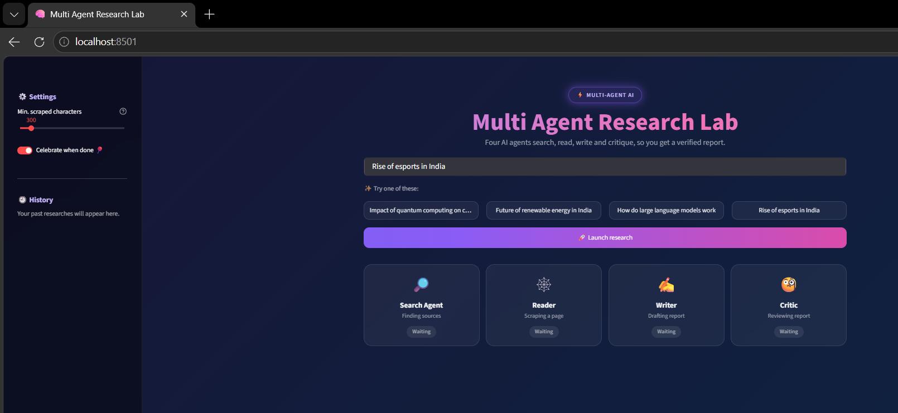
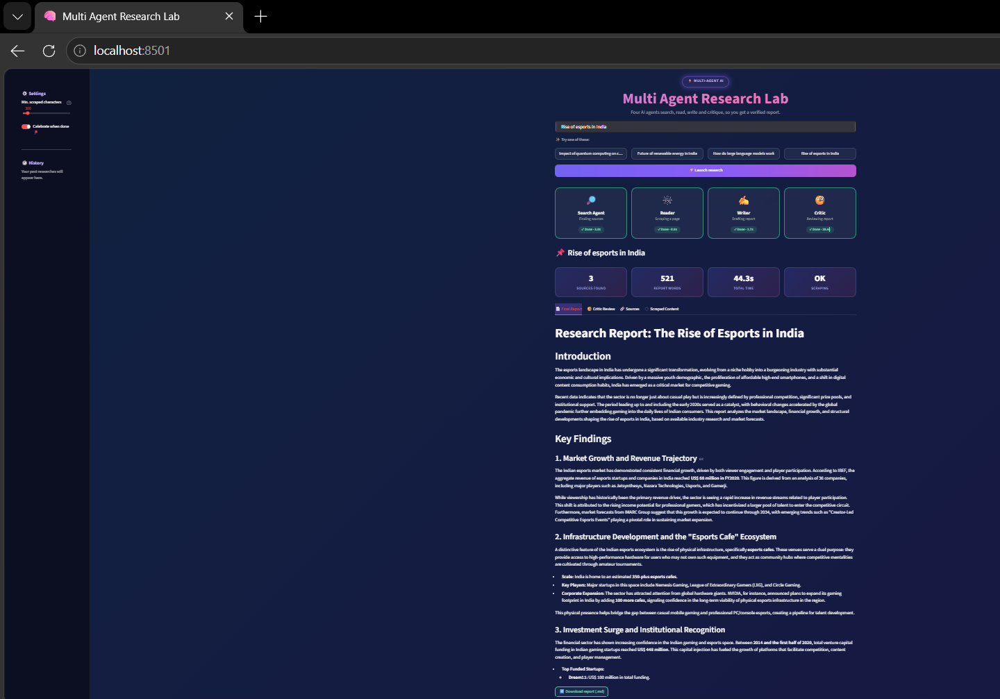
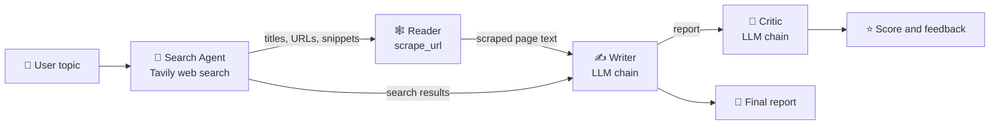

# 🧠 Multi Agent Research Lab

An AI research assistant where **four specialised agents work as a pipeline**: they search the web, read a source page, write a structured report, and then critique it. It runs from the terminal or through an animated **Streamlit** web UI.

## 📸 Screenshots






## 📑 Table of Contents

- [Overview](#-overview)
- [Features](#-features)
- [How It Works](#-how-it-works)
- [Tech Stack](#-tech-stack)
- [Project Structure](#-project-structure)
- [Getting Started](#-getting-started)
- [Usage](#-usage)
- [Configuration](#-configuration)
- [Troubleshooting](#-troubleshooting)
- [Known Limitations](#-known-limitations)
- [Roadmap](#-roadmap)
- [Contributing](#-contributing)
- [License](#-license)
- [Acknowledgements](#-acknowledgements)

---

## 🔍 Overview

Give the app any topic, and it returns a researched report with a quality review:

1. A **Search Agent** finds reliable sources on the web.
2. A **Reader** scrapes the content of a source page, so the report is based on real page text and not only on snippets.
3. A **Writer** drafts a structured report from the gathered evidence.
4. A **Critic** scores the report and lists strengths and areas to improve.

The system is designed to avoid made-up facts. The Writer is told to separate search snippets from scraped content, to disclose it when scraping fails, and to flag claims the evidence can't verify.

---

## ✨ Features

- 🤖 **Multi-agent pipeline** with search, read, write and critique stages
- 🌐 **Live web search** through the Tavily API
- 🕸️ **Web scraping** with BeautifulSoup, with automatic fallback to the next source if a page is empty
- 📝 **Structured reports** with an introduction, key findings, a conclusion and a source list
- 🧐 **Built-in critic** that gives a score out of 10, strengths, improvements and a one-line verdict
- 🎨 **Animated Streamlit UI:**
  - gradient background and glowing, glass-style cards
  - live pipeline tracker with per-step status and timing
  - one-click example topics
  - result metrics (sources found, report words, total time, scraping status)
  - tabs for the report, review, sources and raw scraped content
  - research history in the sidebar
  - report download as Markdown
- 💻 **CLI mode** that prints every step in the terminal
- ⚡ **Fast inference** through Groq

---

## ⚙️ How It Works



| Step | Component | What it does |
|------|-----------|--------------|
| 1 | **Search Agent** (`build_search_agent`) | A LangChain agent with the `web_search` tool. Returns 3 sources with title, URL and snippet. |
| 2 | **Reader** | Scrapes a source page with `scrape_url`. The Streamlit app extracts URLs from the search results and scrapes them directly in Python, skipping pages with too little content. |
| 3 | **Writer** (`writer_chain`) | A prompt, LLM and output parser chain that writes the report from search results and scraped text. |
| 4 | **Critic** (`critic_chain`) | A chain that reviews the report and returns a score, strengths, improvements and a verdict. |

---

## 🛠 Tech Stack

| Layer | Technology |
|-------|------------|
| Language | Python 3.10+ |
| UI | Streamlit with custom CSS animations |
| Agent framework | LangChain (`create_agent`, prompt templates, output parsers) |
| LLM provider | Groq through `langchain-groq` |
| Web search | Tavily (`tavily-python`) |
| Scraping | `requests` and BeautifulSoup4 |
| Config | `python-dotenv` |

---

## 📁 Project Structure

```
Multi Agent System/
├── app.py              # Streamlit web UI (animated, interactive)
├── pipeline.py         # Command-line version of the pipeline
├── agents.py           # LLM setup, search/reader agents, writer and critic chains
├── tools.py            # web_search (Tavily) and scrape_url (BeautifulSoup) tools
├── assets/             # UI screenshots used in this README
├── requirement.txt     # Python dependencies
├── .env                # Your API keys (never commit this)
├── .env.example        # Template showing the required variables
├── .gitignore          # Keeps secrets and virtual env out of Git
└── README.md           # You are here
```

---

## 🚀 Getting Started

### Prerequisites

- **Python 3.10 or newer**
- A free **Groq API key**: <https://console.groq.com>
- A free **Tavily API key**: <https://tavily.com>
- Git

### 1. Clone the repository

```bash
git clone https://github.com/<your-username>/<your-repo-name>.git
cd <your-repo-name>
```

### 2. Create and activate a virtual environment

**Windows (PowerShell):**
```powershell
python -m venv .venv
.venv\Scripts\activate
```

**macOS / Linux:**
```bash
python3 -m venv .venv
source .venv/bin/activate
```

### 3. Install dependencies

```bash
pip install -r requirement.txt
```

### 4. Set up environment variables

Copy the template and add your keys:

```bash
# Windows
copy .env.example .env

# macOS / Linux
cp .env.example .env
```

Open `.env` and fill in:

```env
GROQ_API_KEY=your_groq_api_key_here
TAVILY_API_KEY=your_tavily_api_key_here
```

> ⚠️ Never commit `.env`. It is listed in `.gitignore`.

---

## 💡 Usage

### Option A: Web UI (recommended)

```bash
streamlit run app.py
```

Streamlit opens the app at `http://localhost:8501`.

1. Type a topic, or click one of the example topics.
2. Click **🚀 Launch research**.
3. Watch the four pipeline cards update live.
4. Explore the results in the tabs: **Final Report**, **Critic Review**, **Sources** and **Scraped Content**.
5. Download the report as `.md`, or reopen earlier runs from the sidebar history.

### Option B: Command line

```bash
python pipeline.py
```

Enter a topic when prompted. Each step prints its output in the terminal, along with debug output from the Reader agent.

### Use it in your own code

```python
from pipeline import run_research_pipeline

state = run_research_pipeline("Impact of quantum computing on cryptography")

print(state["report"])    # the written report
print(state["feedback"])  # the critic's review
```

The returned dictionary contains `search_results`, `scraped_content`, `report` and `feedback`.

---

## 🎛 Configuration

| Setting | Where | Description |
|---------|-------|-------------|
| `GROQ_API_KEY` | `.env` | Authenticates the LLM calls. |
| `TAVILY_API_KEY` | `.env` | Authenticates web search. |
| Model name | `agents.py` (`ChatGroq(model=...)`) | Change this to any model available on your Groq account. |
| Temperature | `agents.py` | Set to `0` for consistent, factual output. |
| Search result count | `tools.py` (`max_results`) | Number of results Tavily returns. |
| Scraped text limit | `tools.py` (`text[:5000]`) | Maximum characters taken from a page. |
| Min. scraped characters | UI sidebar slider | Pages with less text than this are skipped. |
| Celebration effect | UI sidebar toggle | Turns the balloons on or off when a run finishes. |
| Report structure | `writer_prompt` in `agents.py` | Edit the prompt to change the report format. |
| Review format | `critic_prompt` in `agents.py` | Edit the prompt to change the critic's output. |

---

## 🧯 Troubleshooting

| Problem | Likely cause | Fix |
|---------|--------------|-----|
| `Error code: 400 ... tool call validation failed ... not in request.tools` | The LLM mistyped a tool name (for example `scrate_url`) when retrying in the Reader agent. | The Streamlit app avoids this by scraping in plain Python. In the CLI, re-run, or apply the same approach as `app.py`. |
| Scraped content is tiny or empty | The page is rendered by JavaScript, so `requests` can't see the content. | The UI skips such pages and tries the next URL. You can also pick a different topic or source. |
| `403` or `Scraping failed` errors | The site blocks scrapers. | Try another source, or add a different User-Agent in `tools.py`. |
| `AuthenticationError` or a missing key error | `.env` is missing or a key is wrong. | Check that `.env` is in the project root and has both keys. |
| `ModuleNotFoundError` | The virtual environment is not active or dependencies are missing. | Activate `.venv` and run `pip install -r requirement.txt`. |
| Model not found | The model name in `agents.py` is not available to your account. | Use a model from your Groq console's model list. |
| Rate limit or token errors | Free-tier limits on Groq or Tavily. | Wait a moment and retry, or use a smaller model or shorter prompts. |
| The old report stays on screen | Streamlit keeps the last result in session state. | Click **Clear everything** in the sidebar, or run a new topic. |

---

## ⚠️ Known Limitations

- Only **one source page** is scraped per run, so the report relies mostly on that page plus search snippets.
- JavaScript-heavy sites can't be scraped with `requests` and BeautifulSoup.
- The Critic reviews the report only. It does not independently check facts against the web.
- Output quality depends on the chosen LLM and on the sources Tavily returns.
- Research history lives in the browser session and is lost when the page is refreshed.

---

## 🗺 Roadmap

- [ ] Scrape and combine multiple sources per run
- [ ] Add a headless-browser fallback (for example Playwright) for JavaScript-rendered pages
- [ ] Let the Writer revise the report using the Critic's feedback
- [ ] Export reports as PDF and DOCX
- [ ] Save research history to disk or a database
- [ ] Apply the direct-scraping approach to `pipeline.py`
- [ ] Add citations that map each claim to a source
- [ ] Add automated tests and a CI workflow
- [ ] Add a Dockerfile for one-command deployment

---

## 🤝 Contributing

Contributions are welcome.

1. Fork the repository
2. Create a feature branch: `git checkout -b feature/your-feature`
3. Commit your changes: `git commit -m "Add your feature"`
4. Push the branch: `git push origin feature/your-feature`
5. Open a Pull Request

Please keep API keys out of commits and describe what your change does.

---

## 📄 License

This project is released under the **MIT License**. Add a `LICENSE` file to the repository (GitHub can generate one when you click **Add file → Create new file → LICENSE**).

---

## 🙏 Acknowledgements

- [LangChain](https://www.langchain.com/) for the agent and chain framework
- [Groq](https://groq.com/) for fast LLM inference
- [Tavily](https://tavily.com/) for the search API built for AI agents
- [Streamlit](https://streamlit.io/) for the web UI framework
- [Beautiful Soup](https://www.crummy.com/software/BeautifulSoup/) for HTML parsing

---

<p align="center">Built with ❤️ by <b>&lt;your name&gt;</b> · <a href="https://github.com/&lt;your-username&gt;">GitHub</a></p>
